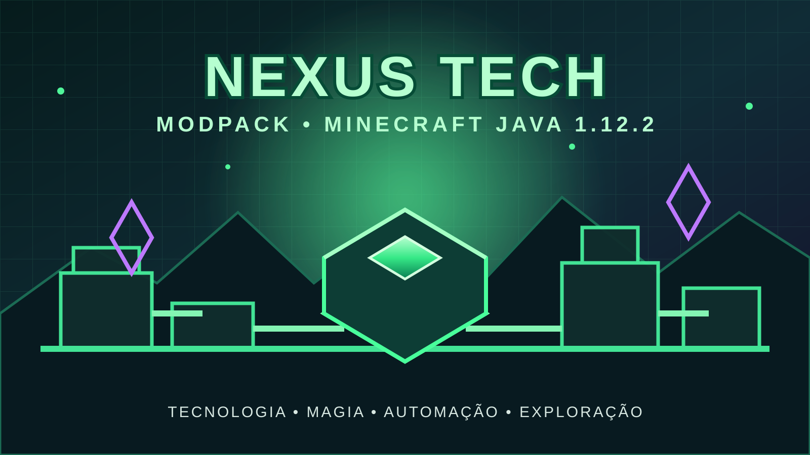

# Nexus Tech 1.12.2

**Nexus Tech 1.12.2** é um modpack para Minecraft Java 1.12.2 que reúne diferentes mods em uma experiência de tecnologia, magia, automação, armazenamento e exploração.

Este repositório será a central do modpack: aqui ficarão a documentação, configurações, lista de mods, dependências, arquivos de distribuição e os projetos próprios que fazem parte do Nexus Tech.

## Identidade do modpack

- **Nome:** Nexus Tech 1.12.2
- **Minecraft:** Java Edition 1.12.2
- **Plataforma:** Forge
- **Foco:** tecnologia, magia, automação, armazenamento e exploração

## Mods próprios

### ProjectE Storage Bridge

O **ProjectE Storage Bridge** é um dos mods que compõem o Nexus Tech. Ele integra o ProjectE ao Simple Storage Network por meio de um cabo próprio, permitindo acessar itens aprendidos e usar EMC na rede de armazenamento.

Consulte o código-fonte e os detalhes técnicos nas pastas deste repositório.

## Estado atual do repositório

O repositório está sendo organizado para se tornar a central do modpack completo. No momento, o conteúdo versionado inclui principalmente o código-fonte do ProjectE Storage Bridge; a coleção completa de mods, configurações e arquivos de distribuição ainda precisa ser adicionada.

Não considere o modpack completo ou pronto para instalação até que esses arquivos sejam publicados e testados juntos.

## Requisitos do ProjectE Storage Bridge

- Minecraft Java 1.12.2
- Forge 14.23.5.2860 ou superior
- Java 8
- ProjectE PE1.4.1
- Simple Storage Network 1.8.3

## Avisos de compatibilidade

A API `IConnectableLink` do Simple Storage Network 1.8.3 não informa qual jogador solicitou a operação. Por segurança, a ponte do ProjectE Storage Bridge só fica ativa quando há exatamente um jogador conectado.

A compilação do mod não substitui testes dentro do Minecraft. A compatibilidade do conjunto completo do Nexus Tech deverá ser validada com todos os mods instalados simultaneamente.

## Organização planejada

- `mods/` — mods que serão distribuídos com o modpack.
- `config/` — configurações dos mods.
- `docs/` — capa, documentação e informações do projeto.
- `src/` — código-fonte dos mods próprios mantidos neste repositório.

