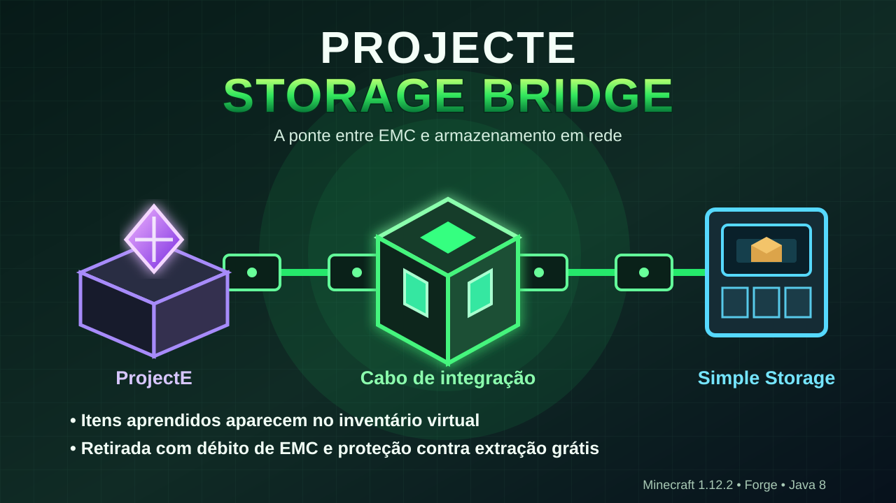

# ProjectE Storage Bridge

Integração entre ProjectE e Simple Storage Network para Minecraft Java 1.12.2.

- Cabo próprio ligado à rede SSN.
- Textura exclusiva 32x32 e renderizador TESR dedicado.
- A textura é reaplicada antes de cada renderização para evitar reaproveitamento de outra textura.
- Facades herdadas da SSN são desativadas no cabo Bridge, inclusive dados antigos salvos.
- Aba criativa própria: ProjectE Storage Bridge, com o cabo como ícone.
- O cabo precisa ficar encostado na Transmutation Table e conectado à rede SSN.
- Retirada virtual de itens aprendidos cobra EMC do jogador; inserção é bloqueada.
- Apenas um cabo principal por rede; simulação não debita EMC.

## Instalação
Minecraft 1.12.2, Forge 14.23.5.2860 ou superior, Java 8, ProjectE PE1.4.1 e Simple Storage Network 1.8.3.

## Limitação multiplayer
A API IConnectableLink da SSN 1.8.3 não informa o jogador solicitante. Por segurança, a ponte só fica ativa com exatamente um jogador conectado.

## Testes pendentes
A compilação não substitui testes no jogo. Verificar renderização em seis direções, reload de chunks, resource packs, item da aba criativa, retirada EMC, saldo insuficiente, múltiplos cabos e multiplayer.
